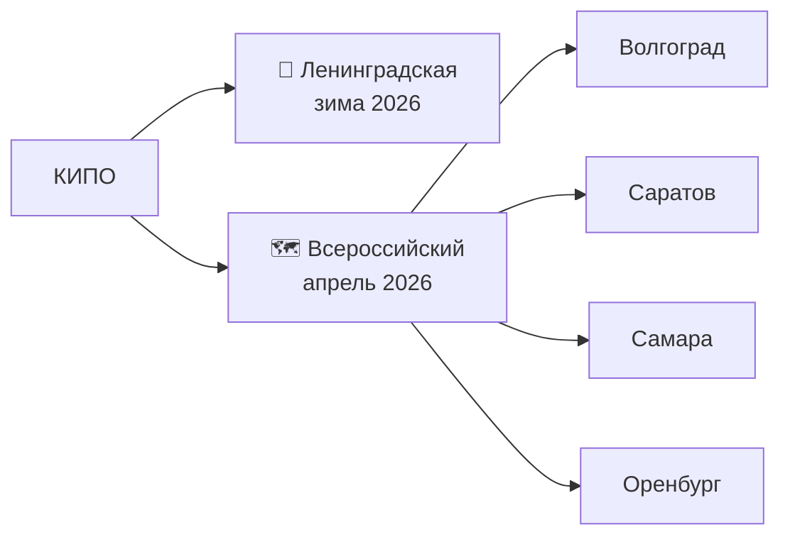

# 🏆 Чемпионаты

> ~~[[Главная|← На главную]]~~

---

## 🥇 1-й раз — Станица Ленинградская (зима 2026)
| Поле | Значение |
|------|----------|
| Место | Станица Ленинградская |
| Период | зима 2026 |
| Результат | **🥇 1 место** |

**Впечатления:** Отлично съездили, куча классных воспоминаний. Через месяц ездил на награждение — 5 дней с 9 по 14 февраля 2026.

---

## 🗺️ 2-й раз — Всероссийский чемпионат (апрель 2026)
| Поле | Значение |
|------|----------|
| Маршрут | Волгоград → Саратов → Самара → Оренбург |
| Даты | 5–15 апреля 2026 |

**Впечатления:** Круто съездил, посмотрел Россию. Было грустно, но интересно.

---

---

## 🔗 Связанное
- [[КИПО]] — соревнования от колледжа
